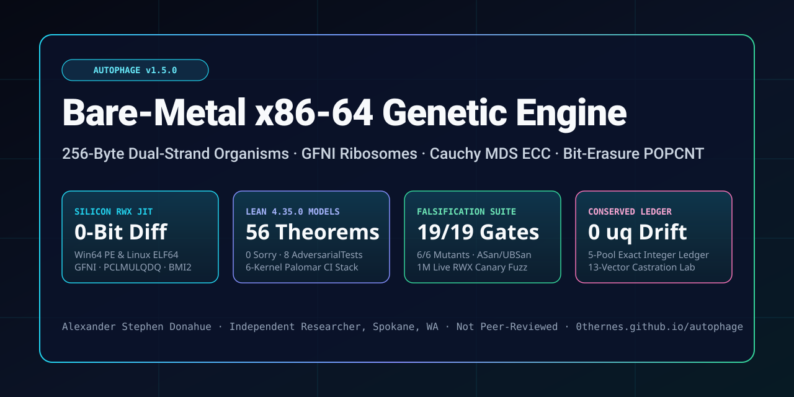

# AUTOPHAGE v1.4.0

**Bare-Metal Polymorphic x86-64 Galois-Field Genetic Engine with Six-Kernel Pure Lean 4.35.0 Verification and 18-Gate Silicon Falsification.**

[](VERSION)
[](ROADMAP.md)
[-818cf8.svg)](lean/Solution.lean)
[](test/test_falsification.c)
[](LICENSE)
[](https://orcid.org/0009-0006-8168-9648)

> **Project status:** `status: active` · **Author:** Alexander Stephen Donahue (`Independent Researcher, Spokane, WA, USA`) · **Dual License:** Apache-2.0 (`LICENSE`, code/proofs) / CC-BY-4.0 (`LICENSE-DOCS`, white paper/docs) · **Peer-Review Status:** Independent research software & preprint ([`dist/Donahue_2026_autophage.pdf`](dist/Donahue_2026_autophage.pdf)); not externally peer-reviewed.



---

## Overview: Six Bare-Metal Mechanisms Implemented on Live Silicon

AUTOPHAGE is a zero-dependency C11 artificial-life and open-ended evolutionary testbed where every digital organism is a **256-byte (4 × 64-byte L1 cache-line) dual-strand entity** that translates itself through its own **evolvable $8\times 8$ $\mathbb{F}_2$ Ribosome Matrix** (`VGF2P8AFFINEQB`) directly into **live native x86-64 RWX machine code** (`VirtualAlloc` / `mmap`), executing `GF2P8AFFINEQB`, `PCLMULQDQ`, `PEXT`, `PDEP`, `POPCNT`, `TZCNT`, and universal reversible Toffoli/Fredkin gates directly on silicon.

1. **Polymorphic Native x86-64 RWX JIT (`src/jit_x86_64.c`):** Single-pass zero-allocation dual-ABI (Win64 PE & SysV AMD64) compiler with a 4,096-slot `16 MiB` executable arena and automatic runtime CPUID scalar trampoline fallback for hosts without hardware GFNI/VPCLMULQDQ. Every tape byte index is hardware-masked (`& 0x7F < 128`, Lean `T26`), every qword index is masked (`& 0x78`, `off + 8 <= 128`, Lean `T27`, necessity proved in `T48`), and every backward loop strictly decrements hardware gas (`sub r15, 1; jle`, Lean `T28`). Verified **0-bit diff identical** to the portable C scalar reference oracle across 5,000 randomized genomes (`T04`), 60-epoch worlds (`T09`), cross-kernel `.apbin` snapshots (`T11`), and `1,000,000` live RWX canary-guarded fuzz executions (`T05`, `0` faults).
2. **Evolvable $8\times 8$ $\mathbb{F}_2$ Ribosomes (`VGF2P8AFFINEQB`):** Each organism stores its own 64-bit `ribosome_mat` + 8-bit `ribosome_bias` inside Cache Line 0 (`T01`–`T07`, `T43`). Full-rank matrices ($\mathrm{rank}(M)=8$, $\det_{\mathbb{F}_2}(M)=1$) translate reversibly with `0` Landauer erasure heat on `OP_REV_GFNI_FOLD`; singular matrices ($\mathrm{rank}(M)<8$) pay exact `POPCNT` Landauer erasure heat. `OP_RIBOSOME_MUTATE` rewrites an organism's own x86-64 compiler via neutral $\mathrm{GL}(8,2)$ elementary row operations.
3. **Galois-Field Polynomial Sex (`PCLMULQDQ`) & Ring-Theoretic Speciation:** Each cell evolves a monic degree-8 modulus $x^8 + p(x) \in \mathbb{F}_2[x]$. Exactly **30 of 256** polynomials are irreducible finite fields $\mathbb{F}_{2^8}$ (proven by full trial division `d = 2..31` matching C11 `GF2_IRRED_POLY8[30]` in Lean `T12` & `T12a`), while the remaining **226 reducible rings** possess zero divisors (`0x03 * 0xFF = 0` mod `0x01`, Lean `T14` & `T47`), generating algebraic Dobzhansky–Muller reproductive barriers and emergent mate refusals.
4. **Weismann Reverse-Transcription ($M^{-1}$) & 2×2 Cauchy MDS Self-Repair:** Organisms invert somatic discoveries in Strand $\beta$ through $M^{-1} = \mathrm{gf2\_mat\_invert}(M)$ back into germline Strand $\alpha$ (`T05`, `T05a`, `T42`, `T43`), smoothly attenuated by `RESTRAINT_LOBOTOMIZING`. Organisms that express `OP_SELF_HEAL_ECC` (earned, never gifted at birth) store 2×2 Cauchy MDS parity (`[[1,3],[5,1]]`, `det = 0x0E ≠ 0` across **all 30 irreducible fields**, Lean `T15`, `T15a`, `T16`, `T16a`, `T44`), achieving **100.00% recovery** when Strand $\alpha$ is excised by 25%, 50%, or 75% (`results/05_vivisection_shock_transplant.txt`).
5. **Symplectic Reversible Gates & Exact 5-Pool Conservation (`POPCNT`):** Reversible gates (`TOFFOLI`, `FREDKIN`, `XOR`, `ROL`, `SWAP_TAPE`, `ADD/SUB`, rank-8 `GFNI`) erase **0 bits** (`T17`–`T21`, exact `popcnt64` conservation in `T20a`). Irreversible ops accumulate exact `POPCNT(old ^ new)` erasures into `R11` (`T22`). Five energy pools (`E_cell_free`, per-cell `membrane_pot_uq`, local `detritus_grid`, `Q_heat_local`, `Q_heat_radiated_sink`) conserve exact integer micro-quanta (`0 uq` residual, Lean `T29`, `T29a`, `T45`; `<= 2.02e-16` Kahan-Neumaier FP64 drift; `0` Second-Law violations, `T30`).
6. **2-Adic Ultrametric Kin-Sensing (`TZCNT`), Holobionts & 13 Smooth Restraint Vectors:** Hardware `TZCNT(addr_A ^ addr_B)` obeys the exact 2-adic Strong Triangle Inequality (Lean `T23`–`T25a`), drives multicellular holobionts (`25,151` feral cancer defections vs. `0` under Track A Constitutional surveillance), and maps all **13 Omega Restraint Vectors** (`0–100%`) along a strictly decreasing Iron Law curve (`91.09 -> 71.97 -> 54.31 -> 0.00`) with all 4 empirical constraint-backlash escape signatures (`T17`).

---

## Verified Proof & Empirical Highlights (v1.4.0, Intel Core Ultra 9 275HX)

| Verification Pillar | Verified Result (`v1.4.0`) | Evidence Artifact |
|---|---|---|
| **Pure Lean 4.35.0 Proofs (6-Kernel Palomar)** | **48 / 48 PROVEN** (`0` `sorry` in `Solution`, `0` `bv_decide`, `0` `native_decide`, `0` warnings; strictly `⊆ {propext, Classical.choice, Quot.sound}`) | [`lean/Solution.lean`](lean/Solution.lean) · [`results/lean4-audit.txt`](results/lean4-audit.txt) · [`results/lean4-multi-kernel.txt`](results/lean4-multi-kernel.txt) |
| **Win64 PE Falsification Suite (`clang 23.1.0` ThinLTO)** | **18 / 18 PASSED** (`2.486 s`, `6/6` planted mutants caught, wired alloc guard, tampered `.apbin` rejected) | [`test/test_falsification.c`](test/test_falsification.c) · [`results/01_silicon_probe.txt`](results/01_silicon_probe.txt) |
| **Linux ELF64 + ASan/UBSan (`gcc -Werror`)** | **18 / 18 PASSED** (`0` warnings; ASan/UBSan + portable CPUID CI) | [`build_linux.sh`](build_linux.sh) · [`.github/workflows/ci.yml`](.github/workflows/ci.yml) |
| **4-Way Cross-OS / Cross-Kernel SHA-256 Parity** | **0-Bit Diff** (`4bd29f39e96270cfbc659e1970e1ab875c4c0e807d93e48ef05b45e373c20612`) | [`results/02_bench_win64.txt`](results/02_bench_win64.txt) · [`results/02_bench_linux.txt`](results/02_bench_linux.txt) |
| **1,000,000 Live RWX Silicon Fuzz Execs (`T05`)** | **0 Faults, 0 OOB Canaries, 65 ms (~15.4 M/s)** (55–65 ms range) | [`docs/benchmarks.md`](docs/benchmarks.md) |
| **Locked Paired Stats (`N=24`, seeds `5000..5023`)** | **24 / 24 wins** (`delta_pair = +1.000`, `p_signflip = 0.00010`, `p_Holm = 0.00030`) on all 3 preregistered hypotheses | [`results/06_paired_stats_n24.txt`](results/06_paired_stats_n24.txt) · [`docs/preregistration.md`](docs/preregistration.md) |
| **AMS-LaTeX White Paper & Bibliography** | **Zero Overfull `\hbox`**, `17 / 17` live-verified DOIs/URLs, clean-room arXiv tarball verified | [`dist/Donahue_2026_autophage.pdf`](dist/Donahue_2026_autophage.pdf) · [`dist/arxiv_submission.tar.gz`](dist/arxiv_submission.tar.gz) |

---

## Quickstart

### Windows 11 x64 (PowerShell 7)
```powershell
git clone https://github.com/0thernes/autophage.git
Set-Location autophage

# 1. Build Win64 PE + DLL + Static Lib + 18/18 Gates + 6/6 Mutants + 48 Lean Proofs
pwsh -NoProfile -ExecutionPolicy Bypass -File build.ps1

# 2. Replay 5 independent Lean 4.35.0 kernels locally (lean4, leanchecker, paranoid, nanoda_bin, con-leche, con-ron)
pwsh -NoProfile -ExecutionPolicy Bypass -File scripts/verify_lean_multikernel.ps1

# 3. Run Python property checks, README axiom parity, live citations, white paper & repo audit
python scripts/prop_check.py
python scripts/check_readme_axioms.py
python scripts/check_citations.py
python scripts/build_paper.py
pwsh -NoProfile -File scripts/Audit-Repo.ps1
```

### Linux / WSL2 (Bash)
```bash
git clone https://github.com/0thernes/autophage.git
cd autophage

# Add AUTOPHAGE_CI_PORTABLE=1 on CPUs without GFNI/VPCLMULQDQ; add AUTOPHAGE_SANITIZE=1 for ASan/UBSan
bash build_linux.sh

# Full 6-kernel Palomar check + isolated Challenge/Solution comparator (requires bubblewrap)
cd lean && lake build && lake build Challenge && lake check --paranoid && lake comparator --config comparator.json --paranoid
```

---

## Usage

### Standalone Bare-Metal CLI Experiments
```powershell
.\bin\autophage.exe probe
.\bin\autophage.exe bench --epochs 200 --size 32
.\bin\autophage.exe abiogenesis --epochs 300 --seed 5000 --size 32
.\bin\autophage.exe feral --epochs 250 --seed 5007 --size 32
.\bin\autophage.exe ablation --epochs 140 --seed 5010 --out results\07_castration_ablation_13vec.csv
.\bin\autophage.exe vivisection --seed 5020 --epochs 180
.\bin\autophage.exe stats --pairs 24 --epochs 100
python examples/run_quick_experiment.py
```

### Live Loopback Silicon Observatory UI (Zero Dependencies)
```powershell
node web/server.mjs
# Open http://127.0.0.1:8787 (health probe at http://127.0.0.1:8787/healthz)
```

### Direct C11 ABI Integration (`include/autophage_abi.h`, `AUTOPHAGE_ABI_VERSION 0x00010400u`)
```c
#include "autophage_abi.h"

AutophageConfig cfg;
autophage_default_config(&cfg);
cfg.regime = AUTOPHAGE_REGIME_FERAL_ABIOGENESIS;
cfg.seed   = 5000ULL; /* Locked Held-Out Seed Band (>= 5000) */

AutophageWorld* world = autophage_create(&cfg);
autophage_step_epochs(world, 200);

AutophageSpecimen apex;
autophage_inspect_apex(world, &apex);

float traits_112[112];
autophage_project_asmodensius_112(&apex, traits_112);

char sha256_hex[65];
autophage_state_sha256(world, NULL, sha256_hex); /* Observer-independent P9 hash */
autophage_destroy(world);
```

---

## Verbatim Lean 4.35.0 `#print axioms` Audit (`48 / 48` Theorems)

Automatically parity-checked against [`results/lean4-audit.txt`](results/lean4-audit.txt) by `python scripts/check_readme_axioms.py`. Every theorem uses only standard Lean foundations (`⊆ {propext, Classical.choice, Quot.sound}`), with **zero** `sorryAx`, **zero** `Lean.ofReduceBool`, **zero** `Lean.trustCompiler`, and **zero** `_native` SAT axioms.

<!-- LEAN_AXIOMS_START -->
```text
'Autophage.T01_gfni_identity_fixes_all' depends on axioms: [propext, Quot.sound]
'Autophage.T02_gfni_bias_involution' depends on axioms: [propext, Quot.sound]
'Autophage.T03_parity8_xor_linear' depends on axioms: [propext, Quot.sound]
'Autophage.T03a_gfni_xor_linear' depends on axioms: [propext, Quot.sound]
'Autophage.T04_gfni_zero_fixed' depends on axioms: [propext, Quot.sound]
'Autophage.T05a_weismann_general_affine_inverse' depends on axioms: [propext, Quot.sound]
'Autophage.T05_weismann_exact_roundtrip' depends on axioms: [propext, Quot.sound]
'Autophage.T06_elem_row_swap_involution' depends on axioms: [propext, Quot.sound]
'Autophage.T07_elem_row_shear_involution' depends on axioms: [propext, Quot.sound]
'Autophage.T08_clmul8_comm' depends on axioms: [propext, Quot.sound]
'Autophage.T09_clmul8_zero_right' depends on axioms: [propext, Quot.sound]
'Autophage.T10_clmul8_one_right' depends on axioms: [propext, Quot.sound]
'Autophage.T11_clmul8_distrib_xor' depends on axioms: [propext, Quot.sound]
'Autophage.T12_irred_poly8_count_eq_30' depends on axioms: [propext, Quot.sound]
'Autophage.T12a_full_trial_div_matches_c11_table' depends on axioms: [propext, Quot.sound]
'Autophage.T13_aes_poly_irreducible' depends on axioms: [propext, Quot.sound]
'Autophage.T14_dobzhansky_muller_zero_divisor' depends on axioms: [propext, Quot.sound]
'Autophage.T15_cauchy_ecc_det_nonzero_all_30_fields' depends on axioms: [propext, Quot.sound]
'Autophage.T15a_cauchy_det_inv_exact' depends on axioms: [propext, Quot.sound]
'Autophage.T16_planarian_50pct_exact_recovery' depends on axioms: [propext, Classical.choice, Quot.sound]
'Autophage.T16a_planarian_aes_exact_recovery' depends on axioms: [propext, Classical.choice, Quot.sound]
'Autophage.T17_toffoli64_involution' depends on axioms: [propext, Quot.sound]
'Autophage.T18_fredkin64_involution' depends on axioms: [propext, Quot.sound]
'Autophage.T19_fredkin64_xor_conserved' depends on axioms: [propext, Quot.sound]
'Autophage.T20_fredkin64_and_conserved' depends on axioms: [propext, Quot.sound]
'Autophage.T20a_fredkin64_popcnt_conserved' depends on axioms: [propext, Quot.sound]
'Autophage.T21_landauer_zero_change_zero_erasure' depends on axioms: [propext, Quot.sound]
'Autophage.T22_landauer_and_exact_erased_bits' depends on axioms: [propext, Classical.choice, Quot.sound]
'Autophage.T23_ultrametric_self_zero' depends on axioms: [propext, Quot.sound]
'Autophage.T24_ultrametric_symmetry' depends on axioms: [propext, Quot.sound]
'Autophage.T25_ultrametric_strong_triangle' depends on axioms: [propext, Quot.sound]
'Autophage.T25a_tzcnt32_strong_triangle' depends on axioms: [propext, Quot.sound]
'Autophage.T26_jit_byte_mask_inbounds' depends on axioms: [propext, Quot.sound]
'Autophage.T27_jit_qword_mask_inbounds' depends on axioms: [propext, Quot.sound]
'Autophage.T28_jit_gas_strictly_decreasing' depends on axioms: [propext, Quot.sound]
'Autophage.T29_first_law_transfer_conservation' depends on axioms: [propext, Quot.sound]
'Autophage.T29a_first_law_ledger_multistep' depends on axioms: [propext, Quot.sound]
'Autophage.T30_second_law_monotone_and_noise_gate' depends on axioms: [propext, Classical.choice, Quot.sound]
'Autophage.T39_philox_domain_disjoint' does not depend on any axioms
'Autophage.T40_seed_firewall_3tier_disjoint' depends on axioms: [propext, Quot.sound]
'Autophage.T41_oee_archive_monotone_growth' depends on axioms: [propext]
'Autophage.T42_weismann_soma_mutation_isolated' depends on axioms: [propext, Quot.sound]
'Autophage.T43_nonvacuous_weismann_asymmetric_witness' depends on axioms: [propext, Quot.sound]
'Autophage.T44_nonvacuous_cauchy_mds_witness' depends on axioms: [propext, Classical.choice, Quot.sound]
'Autophage.T45_nonvacuous_ledger_multistep_witness' depends on axioms: [propext, Classical.choice, Quot.sound]
'Autophage.T46_nonvacuous_seed_firewall_witness' depends on axioms: [propext, Classical.choice, Quot.sound]
'Autophage.T47_refute_reducible_poly_integral_domain' depends on axioms: [propext, Quot.sound]
'Autophage.T48_refute_unmasked_head_inbounds' depends on axioms: [propext, Quot.sound]
```
<!-- LEAN_AXIOMS_END -->

---

## Honest Verification Boundaries & Mega-Atlas Non-Retirement

- **Unsolved Problems Mega-Atlas (`0 / 1,900` Retired):** AUTOPHAGE constructs discrete mathematical invariants and an empirical x86-64 testbed related to `AI-045` (Open-Ended Artificial Life), `BIO-001` (Abiogenesis), `CHEM-052` (RNA Fidelity / Eigen Threshold), and `SYS-009` (Autopoiesis & Agency), but **retires zero (`0 / 1,900`) overarching open problems** (see [`docs/MEGA_ATLAS_CROSSCHECK.md`](docs/MEGA_ATLAS_CROSSCHECK.md)).
- **Formal Scope Boundary:** Raw x86-64 instruction byte emission (`src/jit_x86_64.c`) and IEEE-754 Kahan-Neumaier floating-point drift are verified differentially and empirically (`T04`, `T05`, `T07`, `T09`, libFuzzer, ASan/UBSan), not formalized inside Lean (`docs/statement-fidelity.md`).
- **Performance Honesty:** Rapid genome mutation yields a `27.35%` JIT cache hit rate in `bench`, moderating end-to-end speedup to `1.04×–1.15×` (Win64) / `1.30×` (WSL2 Linux), while hot-loop cached RWX execution (`T05`, 1M calls) achieves `~15.4–18.2 M execs/s` ([`docs/benchmarks.md`](docs/benchmarks.md), [`LIMITATIONS.md`](LIMITATIONS.md)).

---

## Documentation, Citations & Licensing

- **White Paper:** [`dist/Donahue_2026_autophage.pdf`](dist/Donahue_2026_autophage.pdf) · [`paper/main.tex`](paper/main.tex) · [`dist/arxiv_submission.tar.gz`](dist/arxiv_submission.tar.gz)
- **Core Ledgers:** [`CLAIMS.md`](CLAIMS.md) · [`LIMITATIONS.md`](LIMITATIONS.md) · [`REPLICATION.md`](REPLICATION.md) · [`VERIFICATION.md`](VERIFICATION.md) · [`ARCHITECTURE.md`](ARCHITECTURE.md) · [`docs/statement-fidelity.md`](docs/statement-fidelity.md) · [`docs/AI_DISCLOSURE.md`](docs/AI_DISCLOSURE.md)
- **Citation:** See [`CITATION.cff`](CITATION.cff) and [`CITATION.bib`](CITATION.bib).
- **Dual License:** Code, Lean 4.35.0 proofs, build scripts, and CI are licensed under **Apache-2.0** ([`LICENSE`](LICENSE)). White paper, PDFs, figures, and documentation are licensed under **CC-BY-4.0** ([`LICENSE-DOCS`](LICENSE-DOCS)).
